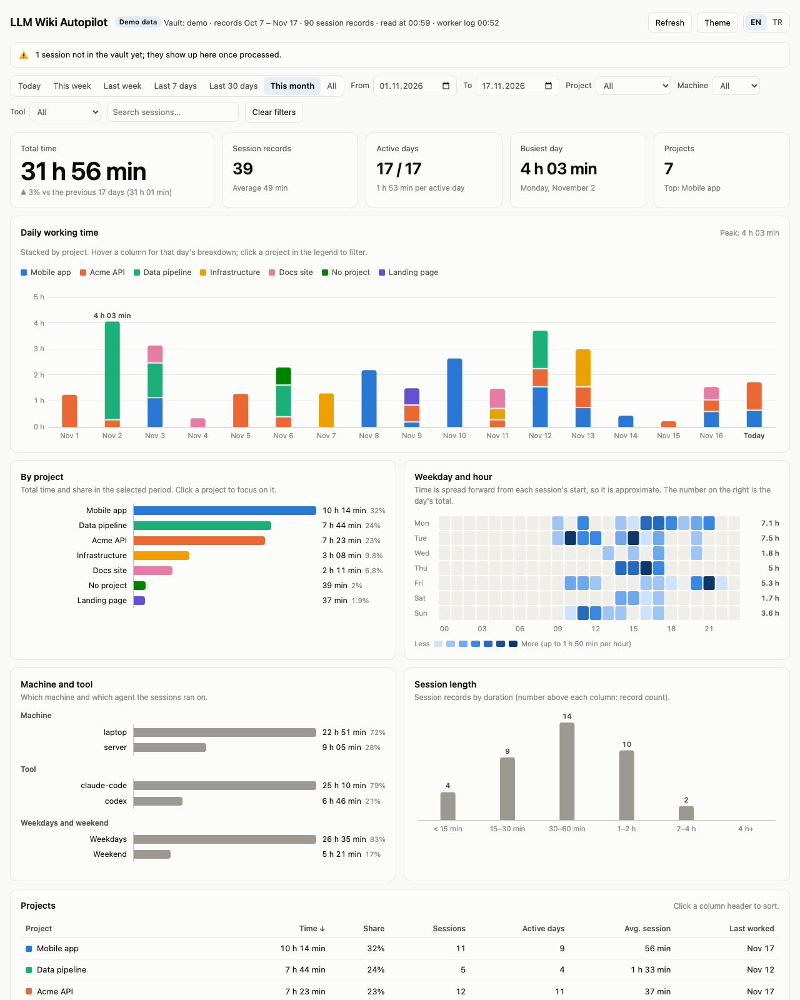

# LLM Wiki Autopilot

**Persistent memory for Claude Code and Codex, written into Obsidian automatically.**

Every coding-agent session you finish becomes part of a wiki: a dated session log, a living page per project,
decisions and lessons. It is Andrej Karpathy's "LLM Wiki" pattern on autopilot: no "save this" prompts, no
manual notes. The wiki is plain Markdown in a git repository, so it syncs across your machines, and every new
Claude Code session starts with the project's current status already in context. A local dashboard shows where
your time went.

[](https://github.com/yusufkaran/llm-wiki-autopilot/actions/workflows/test.yml)


English | [Türkçe](README.tr.md)

<picture>
  <source media="(prefers-color-scheme: dark)" srcset="docs/dashboard-dark.png">
  
</picture>

## Features

- **Runs by itself.** Claude Code hooks and a 5-minute timer pick up every finished session. Nothing to remember.
- **Session log.** Each session becomes an entry in a per-project, per-day file: what was asked, what was done,
  decisions and open items. Trivial sessions get a one-line entry.
- **Living project pages.** Status, open items, decisions and "good to know" are rewritten after every session.
  Architecture decision records, topic pages and tool pages are opened when a session warrants them.
- **Memory at session start.** A `SessionStart` hook gives every new Claude Code session the project's status,
  open items and last five sessions. Agents without hooks, such as Codex, can print the same text with `vm context`.
- **Time tracking.** Active minutes per project and day: `vm report` in the terminal, a local dashboard with charts.
- **Several machines, one memory.** Git sync with a shared ledger, so no session is processed twice. A laptop that
  was closed mid-session can hand its last session to an always-on machine.
- **Source ingest.** Drop an article or PDF into `00-Inbox/` or `05-Raw/clippings/`; `vm ingest` writes a summary
  page and updates the pages it touches.
- **Health check.** `vm lint` finds broken links, orphan pages and missing frontmatter.
- **Safe by default.** Secrets are redacted before anything reaches the model, commits that contain a secret are
  blocked, and the background agent cannot change its own code, config or instruction files.
- **Light.** One Python file using only the standard library. No database, no always-on daemon.
- **English or Turkish** vault pages, CLI output and dashboard.

## Requirements

- macOS or Linux
- Python 3.9+ and git
- [Claude Code](https://docs.claude.com/en/docs/claude-code) CLI, logged in (the worker runs `claude -p`)
- Optional: Codex CLI (its sessions are processed too), Obsidian (to browse the vault)

## Quick start

```bash
git clone https://github.com/yusufkaran/llm-wiki-autopilot ~/.vault-memory/src
~/.vault-memory/src/install.sh --vault ~/Vault --lang en --timer
```

The installer:

1. Creates the vault from the template if the folder is not a vault yet (no `CLAUDE.md`), and runs `git init`.
   A new, empty folder is the safe choice.
2. Copies the CLI, the dashboard and the skill into `<vault>/99-Meta/System/`.
3. Writes `~/.vault-memory/config.json` and links `~/.vault-memory/bin` to the vault's copy of the CLI.
4. Adds `SessionStart`, `Stop` and `SessionEnd` hooks to `~/.claude/settings.json` (after backing it up).
5. Installs the skill into `~/.claude/skills/`.
6. Marks existing transcripts as already processed, so nothing is imported by surprise.
7. With `--timer`, installs a 5-minute timer (launchd on macOS, a systemd user timer on Linux).

| Flag | Meaning |
|---|---|
| `--vault PATH` | Vault folder (created if needed) |
| `--lang en\|tr` | Language of the vault pages; kept on later runs |
| `--machine NAME` | Name of this machine in session files (default: host name) |
| `--remote URL` | Git remote to push the vault to |
| `--timer` | Install the 5-minute background timer |
| `--dashboard` | Start the dashboard at login |
| `--no-hooks` | Don't touch `~/.claude/settings.json` |
| `--no-skill` | Don't install the skill (e.g. when it comes from the plugin) |

The CLI is `vm`, installed in `~/.vault-memory/bin` (add that folder to your `PATH` to type just `vm`).
Open the vault folder in Obsidian if you like; it already has templates, a sessions table view and daily notes set up.

To import past sessions, queue them and let the worker run (one LLM call per session):

```bash
~/.vault-memory/bin/vm backfill --days 14 --dry-run   # see what would be queued
~/.vault-memory/bin/vm backfill --days 14
~/.vault-memory/bin/vm worker --max 500
```

### Sync with a private remote

```bash
~/.vault-memory/src/install.sh --vault ~/Vault --lang en --timer --remote git@github.com:you/my-vault.git
```

Use a **private** repository. The vault holds summaries of everything you work on.

### Add another machine

```bash
git clone git@github.com:you/my-vault.git ~/Vault
~/Vault/99-Meta/System/bin/vm install --machine server --timer
```

The tool lives inside the vault, so every machine runs the version that was last synced. On a laptop that is
often closed, turn on `vm config capture true`; on an always-on machine, `vm config process_remote true`
(see [Several machines](#several-machines)).

### Install as a Claude Code plugin

```
/plugin marketplace add yusufkaran/llm-wiki-autopilot
/plugin install llm-wiki-autopilot@llm-wiki-autopilot
```

Then ask Claude to "set up vault memory". The skill asks where the vault should live, which language to use and
whether to sync with a remote, then runs the installer with `--no-skill`. The plugin ships the skill in English
(`vault-memory`) and Turkish (`vault-hafiza`).

Without the plugin system: `npx skills add yusufkaran/llm-wiki-autopilot`.

## How it works

```
Claude Code / Codex transcripts   (~/.claude/projects, ~/.codex/sessions)
        │  session idle for 20 min; a hook or the 5-minute timer starts the worker
        ▼
vm worker      builds a digest: messages, tool calls, changed files; secrets redacted
        │
        ▼
claude -p      tools limited to Read/Glob/Grep/Edit/Write; appends the session entry,
        │      updates the project page, opens ADRs and topic pages when warranted
        ▼
git commit + push ──► your private remote ──► other machines pull
                                              (SessionStart hook, timer)
```

## Dashboard

```bash
~/.vault-memory/bin/vm dashboard          # http://127.0.0.1:4747
```

- Total time with the change against the previous period of the same length, active days, busiest day.
- Daily columns stacked by project (weekly for long ranges), per-project bars, weekday × hour heatmap.
- Splits by machine, tool, and weekday vs weekend; a session-length histogram; a sortable project table.
- A searchable session list with each session's request, work done, decisions and open items, linked to Obsidian.
- Filters for date range, project, machine and tool; light and dark themes; English and Turkish.

It reads the vault on every refresh and changes nothing. Options: `--port`, `--host`, `--no-open`.
`vm install --dashboard` starts it at login. To try it with sample data: `python3 system/dashboard/server.py --demo`.

## Commands

| Command | What it does |
|---|---|
| `vm worker [--now] [--session ID] [--sync] [--max N]` | Process finished sessions, commit, push |
| `vm tick` | Timer entry point: `capture`, then `worker` |
| `vm hook session-start\|session-end\|stop` | Claude Code hook entry point |
| `vm report [--project P] [--from D --to D \| --days N \| --week this\|last] [--detail] [--json]` | Time per project and day |
| `vm status [--json]` | Queue, alert, last log lines |
| `vm dashboard [--host H] [--port N] [--no-open]` | Local dashboard |
| `vm sync` | Pull, commit, push |
| `vm index` | Regenerate `index.md` |
| `vm lint` | Write a health report to `99-Meta/Lint/` |
| `vm context [--cwd DIR]` | Print the project memory for a folder (for agents without hooks, like Codex) |
| `vm ingest [--now] [--path P] [--dry-run]` | Process new files in the inbox folders |
| `vm backfill --days N [--project P] [--exclude X] [--dry-run]` | Queue sessions from before installation |
| `vm baseline [--force]` | Mark all existing transcripts as processed |
| `vm digest PATH [--offset N] [--show]` | Show the digest of a transcript (debugging) |
| `vm config [KEY [VALUE]]` | Show or change this machine's settings |
| `vm install [--machine NAME] [--timer] [--dashboard] [--no-hooks] [--no-skill]` | Set up this machine |
| `vm uninstall [--keep-skill]` | Remove hooks, timer, dashboard service and skill from this machine |

## Configuration

Settings come from two files. Per-machine values override shared ones.

- **Shared:** `<vault>/99-Meta/System/config.json`, synced with the vault.
- **This machine:** `~/.vault-memory/config.json`, changed with `vm config KEY VALUE`.

| Key | Default | Usually set in | Meaning |
|---|---|---|---|
| `language` | `en` | shared | Language of vault pages and CLI output (`en`, `tr`) |
| `timezone` | system | shared | IANA name used for dates and times, e.g. `Europe/Berlin` |
| `idle_minutes` | `20` | shared | A session is processed after this long without new messages |
| `gap_cap_minutes` | `5` | shared | Longest gap between two messages that still counts as active time |
| `model` | `sonnet` | shared | Model the worker uses |
| `effort` | `medium` | shared | Reasoning effort for the worker |
| `max_budget_usd` | `2.0` | shared | Spending cap per worker call |
| `max_per_run` | `6` | shared | Session entries processed per worker run |
| `sources` | `["claude", "codex"]` | shared | Which agents' transcripts to read |
| `projects_roots` | `~/Projects`, `~/projects`, `~/code`, `~/dev`, `~/src`, `~/work`, … | shared | Folders whose direct subfolders are projects |
| `ingest_dirs` | `00-Inbox`, `05-Raw/clippings`, `05-Raw/files` | shared | Folders `vm ingest` watches |
| `vault` | – | machine | Path of the vault |
| `machine` | host name | machine | Machine name used in file names |
| `claude_bin` | `claude` | machine | Path of the Claude Code CLI |
| `capture` | `false` | machine | Push redacted digests of unprocessed sessions to `outbox/<machine>` |
| `process_remote` | `false` | machine | Process other machines' outbox packets they left unprocessed |

## How time is measured

Time is active time with an agent. For each session the gaps between consecutive messages are added up, and
each gap counts for at most `gap_cap_minutes` (5 by default), so lunch breaks and idle windows don't count. Time
spent without an agent is not counted. Two sessions running at the same time are both counted, so a day can
add up to more than the hours on the clock.

## Privacy and safety

- Everything runs on your machines. Transcripts are never copied anywhere. What leaves the machine is the
  redacted digest sent to Claude through your own CLI login and, only with `capture` on, the same digest pushed
  to the `outbox/<machine>` branch of your own git remote.
- Known secret patterns (API keys, tokens, private keys, passwords in `key=value` form, credentials in URLs) are
  redacted in digests. If a value in a known key format still ends up in a vault change, the commit is blocked
  and `vm status` shows an alert until you remove it.
- The worker runs `claude -p` with only Read, Glob, Grep, Edit and Write, no Bash, no MCP servers, hooks
  disabled, and a per-call budget cap. It works inside the vault folder and runs no git commands; the script
  commits.
- The worker reads untrusted text (session digests, web clippings), so what it may change is enforced in code,
  not only in its instructions. Before each call the protected paths are snapshotted: `99-Meta/` (the tool, the
  shared config, templates), `index.md`, `log.md`, agent instruction files such as `CLAUDE.md` and `AGENTS.md` at
  any depth and in any letter case, every dot file and dot folder at any depth (`.claude/`, `.obsidian/` plugins, …)
  and the git metadata in `.git`. Any change to them is reverted
  before the commit, and `vm status` shows an alert. Injected text can still shape what the worker writes into
  ordinary pages, so review sources you ingest from the web.
- `claude_bin`, `path`, `setting_sources`, `capture` and `process_remote` are read only from the per-machine
  config; the shared config in the vault cannot set them.
- The dashboard binds to `127.0.0.1` and only reads.

## Resource use

Measured on a Mac with 258 transcripts (2.6 GB, the largest 330 MB):

- The timer and the after-reply hook start a short Python process (about 30 MB, 0.1 s) and exit. Finding pending
  sessions takes 0.02 s; transcripts are read as a stream, so even a 330 MB file stays near 100 MB of memory.
- Background work runs at low priority (`nice 10`; on macOS the timer is a `Background` launchd job with low-priority
  I/O, on Linux `IOSchedulingClass=idle`).
- After an agent reply, digests are pushed at most once a minute (`capture_interval_seconds`).
- The heaviest step is the `claude -p` call itself, once per finished session, one at a time.
- The dashboard server idles at about 30 MB and 0% CPU; the page polls once a minute, only while its tab is
  visible, and redraws only when something changed. No GPU work beyond normal page rendering.

## Cost

Each finished session with real content is one `claude -p` call, with `sonnet` by default and capped at
`max_budget_usd` per call. Short sessions (a greeting, a one-line question) are logged without a call.
`vm backfill` makes one call per queued session, so try `--dry-run` first.

## Project mapping

- A folder directly under one of the `projects_roots` is one project, including every git repository inside it.
- A git repository outside those roots is a project named after its folder.
- Anything else (home folder, temp folders, `~/.claude`) belongs to no project and goes to
  `05-Raw/sessions/` as `general`.
- A session is matched to a project page by the git remote in the page's `repos` field first, then by the folder
  name in `folders`. The worker adds new remotes and folders there. To merge two folders into one project, add
  the second folder's name (or its remote) to the first project's `folders` (or `repos`).

## Several machines

- Each machine processes its own sessions and appends `machine session offset` lines to
  `99-Meta/System/processed.txt`. The ledger travels with the vault, so no session is processed twice.
- With `capture` on, a machine pushes redacted digests of its unprocessed sessions to the `outbox/<machine>`
  branch after every agent reply. The branch is overwritten each time and never enters `main`.
- With `process_remote` on, a machine processes those packets if their owner hasn't done so within
  `remote_idle_minutes` (30), and records them under the owner's name. A laptop closed mid-session still gets
  its last session into the vault.
- On a push conflict, the local work is saved to a backup branch, the machine returns to the remote state, and
  the affected sessions are processed again.

## Upgrading

```bash
git -C ~/.vault-memory/src pull --ff-only
~/.vault-memory/src/install.sh --vault ~/Vault
~/.vault-memory/bin/vm sync
```

The installer copies the new CLI, dashboard and skill into the vault and keeps your language and settings.
`vm sync` pushes them; other machines run the new version after their next pull.

## Uninstall

```bash
~/.vault-memory/bin/vm uninstall
```

Removes the hooks, timer, dashboard service and skill from this machine. Your vault is left as it is.

## Troubleshooting

- `vm status` shows the queue, the last worker log lines and any alert. The full log is
  `~/.vault-memory/logs/worker.log`.
- **Commit blocked by a secret:** run `git status` in the vault, remove the value from the changed file, run `vm sync`.
- **Sync conflict:** run `git pull --rebase` in the vault, resolve the file, run `vm sync`.
- **Nothing gets processed:** check that `claude` runs from a non-interactive shell (`vm config claude_bin`),
  that the timer is installed (`vm install --timer`), and that the session has been idle for `idle_minutes`.
  `vm worker --now` skips the wait.
- **A session landed in the wrong project:** fix `repos` / `folders` on the project pages; later sessions follow.

## FAQ

**Do I need Obsidian?** No. The vault is a folder of Markdown files in git; Obsidian is just a good way to read it
(templates, a sessions table and daily notes are set up for it).

**Does my code or my transcripts leave the machine?** Only a redacted digest of each session goes to Claude, through
your own Claude Code login, and the resulting pages go to the git remote you choose. See
[Privacy and safety](#privacy-and-safety).

**Which agents are supported?** Claude Code and the Codex CLI: their transcripts are read from `~/.claude/projects`
and `~/.codex/sessions`. Session-start memory is automatic in Claude Code; other agents can call `vm context`.

**What does it cost?** One `claude -p` call per finished session that has real content. See [Cost](#cost).

**Can I import my old sessions?** Yes, with `vm backfill --days N`; see [Quick start](#quick-start).

## Repository layout

```
install.sh            creates or upgrades a vault and sets up this machine
system/bin/           vm and vault_memory.py (copied into <vault>/99-Meta/System/bin)
system/dashboard/     server.py and index.html
skills/               vault-memory (English) and vault-hafiza (Turkish) skills
template/             vault skeleton: common files plus en/ and tr/ rules and page templates
docs/SPEC.md          file formats, CLI and dashboard API
tests/                tests (they use a fake LLM; no API calls)
```

## Credits

The vault model follows Andrej Karpathy's "LLM Wiki" idea: an LLM that maintains a wiki from the sources you
give it, instead of answering from scratch every time.

## License

MIT. See [LICENSE](LICENSE).
