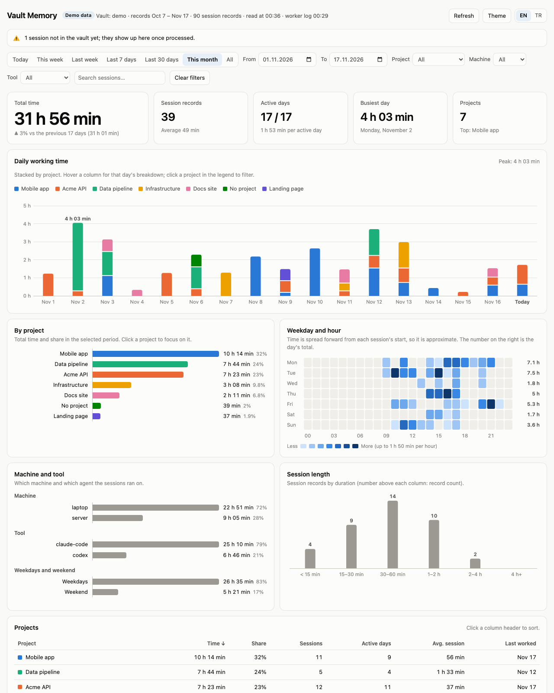

# LLM Wiki Autopilot

[English](README.md) | Türkçe

**Andrej Karpathy'nin LLM Wiki modeli, otomatik pilotta: Claude Code ve Codex için kalıcı hafıza; Obsidian'a
kendiliğinden yazılır.**

Bitirdiğin her Claude Code ve Codex oturumu bir Obsidian vault'una
damıtılır: tarihli oturum kaydı, güncel proje sayfası, kararlar, öğrenimler. Vault bir git deposundaki düz
Markdown'dır; makinelerin arasında eşitlenir ve yeni oturumlar projenin güncel durumunu bilerek başlar. Andrej
Karpathy'nin "LLM Wiki" modelini izler: sen kaynak getirir ve soru sorarsın, yazma ve bakım işini ajan yapar.
Yerel bir pano da zamanının nereye gittiğini gösterir.

<picture>
  <source media="(prefers-color-scheme: dark)" srcset="docs/dashboard-dark.png">
  
</picture>

## Nasıl çalışır

```
Claude Code / Codex transkriptleri   (~/.claude/projects, ~/.codex/sessions)
        │  oturum 20 dk boşta kalır; bir hook ya da 5 dakikalık zamanlayıcı işçiyi başlatır
        ▼
vm worker      özet (digest) çıkarır: mesajlar, araç çağrıları, değişen dosyalar; sırlar gizlenir
        │
        ▼
claude -p      yalnızca Read/Glob/Grep/Edit/Write araçlarıyla oturum kaydını ekler,
        │      proje sayfasını günceller, gerekirse ADR ve konu sayfası açar
        ▼
git commit + push ──► özel uzak depon ──► diğer makineler çeker
                                          (SessionStart hook'u, zamanlayıcı)
```

## Özellikler

- **Otomatik oturum kaydı.** Biten her oturum, proje ve gün başına bir dosyaya istek, yapılanlar, kararlar ve
  açık işlerle eklenir. Önemsiz oturumlar tek satırla geçer.
- **Canlı proje sayfaları.** Durum, açık işler, kararlar ve "bilinmesi gerekenler" her oturumdan sonra yeniden yazılır.
- **Oturum başında hafıza.** `SessionStart` hook'u, projenin güncel durumunu, açık işlerini ve son beş oturumunu
  her yeni Claude Code oturumunun bağlamına koyar.
- **Süre takibi.** Oturum başına etkin dakika, tablo için `vm report`, grafik için yerel pano.
- **Birden çok makine.** Ortak bir defterle git eşitlemesi; aynı oturum iki kez işlenmez. Oturumun ortasında
  kapağı kapanan dizüstü, son oturumunu hep açık bir makineye devredebilir.
- **Kaynak işleme.** Bir yazıyı ya da PDF'i `00-Inbox/` veya `05-Raw/clippings/` altına at; `vm ingest` özet
  sayfası yazar ve değdiği sayfaları günceller.
- **Sağlık kontrolü.** `vm lint` kopuk linkleri, yetim sayfaları ve eksik frontmatter'ı bulur.
- **İngilizce ya da Türkçe** vault sayfaları, CLI çıktısı ve pano.
- **Küçük ayak izi.** Yalnızca standart kütüphane kullanan tek bir Python dosyası; veritabanı yok, isteğe bağlı
  pano dışında sunucu süreci yok.

## Gereksinimler

- macOS ya da Linux
- Python 3.9+ ve git
- Oturum açılmış [Claude Code](https://docs.claude.com/en/docs/claude-code) CLI (işçi `claude -p` çalıştırır)
- İsteğe bağlı: Codex CLI (oturumları da işlenir), Obsidian (vault'a göz atmak için)

## Hızlı başlangıç

```bash
git clone https://github.com/yusufkaran/karpathy-llm-wiki-autopilot ~/.vault-memory/src
~/.vault-memory/src/install.sh --vault ~/Vault --lang tr --timer
```

Kurulum betiği:

1. Klasör henüz bir vault değilse (`CLAUDE.md` yoksa) şablondan vault oluşturur ve `git init` çalıştırır.
   Yeni ve boş bir klasör en güvenlisidir.
2. CLI'ı, panoyu ve skill'i `<vault>/99-Meta/System/` altına kopyalar.
3. `~/.vault-memory/config.json` dosyasını yazar ve `~/.vault-memory/bin`'i vault'taki CLI kopyasına bağlar.
4. `~/.claude/settings.json` dosyasına (önce yedeğini alarak) `SessionStart`, `Stop` ve `SessionEnd` hook'larını ekler.
5. Skill'i `~/.claude/skills/` altına kurar.
6. Mevcut transkriptleri işlenmiş sayar; habersiz içe aktarma olmaz.
7. `--timer` verilirse 5 dakikalık zamanlayıcıyı kurar (macOS'ta launchd, Linux'ta systemd kullanıcı zamanlayıcısı).

| Bayrak | Anlamı |
|---|---|
| `--vault YOL` | Vault klasörü (gerekirse oluşturulur) |
| `--lang en\|tr` | Vault sayfalarının dili; sonraki çalıştırmalarda korunur |
| `--machine AD` | Oturum dosyalarında bu makinenin adı (varsayılan: bilgisayar adı) |
| `--remote ADRES` | Vault'un gönderileceği git uzak deposu |
| `--timer` | 5 dakikalık arka plan zamanlayıcısını kur |
| `--dashboard` | Panoyu oturum açılışında başlat |
| `--no-hooks` | `~/.claude/settings.json` dosyasına dokunma |
| `--no-skill` | Skill'i kurma (ör. plugin'den geliyorsa) |

İstersen vault klasörünü Obsidian'da aç; şablonlar, oturum tablosu görünümü ve günlük notlar hazır gelir.

Geçmiş oturumları içe aktarmak için kuyruğa al ve işçiyi çalıştır (oturum başına bir LLM çağrısı):

```bash
~/.vault-memory/bin/vm backfill --days 14 --dry-run   # nelerin kuyruğa gireceğini gör
~/.vault-memory/bin/vm backfill --days 14
~/.vault-memory/bin/vm worker --max 500
```

### Özel bir uzak depoyla eşitleme

```bash
~/.vault-memory/src/install.sh --vault ~/Vault --lang tr --timer --remote git@github.com:sen/vault-um.git
```

**Özel (private)** bir depo kullan. Vault, üzerinde çalıştığın her şeyin özetini taşır.

### Başka bir makine ekleme

```bash
git clone git@github.com:sen/vault-um.git ~/Vault
~/Vault/99-Meta/System/bin/vm install --machine sunucu --timer
```

Araç vault'un içinde durduğu için her makine en son eşitlenen sürümü çalıştırır. Kapağı sık kapanan dizüstünde
`vm config capture true`, hep açık makinede `vm config process_remote true` aç
(bkz. [Birden çok makine](#birden-çok-makine)).

### Claude Code plugin'i olarak kurma

```
/plugin marketplace add yusufkaran/karpathy-llm-wiki-autopilot
/plugin install llm-wiki-autopilot@llm-wiki-autopilot
```

Sonra Claude'a "vault hafıza kurulumunu yap" de. Skill vault'un nerede duracağını, dilini ve bir uzak depoyla
eşitlenip eşitlenmeyeceğini sorar, sonra kurulum betiğini `--no-skill` ile çalıştırır. Plugin skill'i İngilizce
(`vault-memory`) ve Türkçe (`vault-hafiza`) olarak getirir.

Plugin sistemi olmadan: `npx skills add yusufkaran/karpathy-llm-wiki-autopilot`.

## Pano

```bash
~/.vault-memory/bin/vm dashboard          # http://127.0.0.1:4747
```

- Toplam süre ve aynı uzunluktaki önceki döneme göre değişim, aktif gün, en yoğun gün.
- Projeye göre yığılmış günlük sütunlar (uzun aralıklarda haftalık), proje çubukları, gün × saat ısı haritası.
- Makine, araç ve hafta içi / hafta sonu kırılımları; oturum uzunluğu dağılımı; sıralanabilir proje tablosu.
- Her oturumun isteği, yapılanları, kararları ve açık işleriyle aranabilir oturum listesi; Obsidian bağlantılı.
- Tarih aralığı, proje, makine ve araç filtreleri; açık ve koyu tema; İngilizce ve Türkçe.

Her yenilemede vault'u okur, hiçbir şeyi değiştirmez. Seçenekler: `--port`, `--host`, `--no-open`.
`vm install --dashboard` panoyu oturum açılışında başlatır. Örnek veriyle denemek için:
`python3 system/dashboard/server.py --demo`.

## Komutlar

| Komut | İş |
|---|---|
| `vm worker [--now] [--session ID] [--sync] [--max N]` | Biten oturumları işler, commit ve push yapar |
| `vm tick` | Zamanlayıcı girişi: önce `capture`, sonra `worker` |
| `vm hook session-start\|session-end\|stop` | Claude Code hook girişi |
| `vm report [--project P] [--from T --to T \| --days N \| --week this\|last] [--detail] [--json]` | Proje ve gün bazında süre |
| `vm status [--json]` | Kuyruk, uyarı, son kayıt satırları |
| `vm dashboard [--host H] [--port N] [--no-open]` | Yerel pano |
| `vm sync` | pull, commit, push |
| `vm index` | `index.md`'yi yeniden üretir |
| `vm lint` | `99-Meta/Lint/` altına sağlık raporu yazar |
| `vm context [--cwd KLASÖR]` | Bir klasörün proje hafızasını yazdırır (Codex gibi hook'suz ajanlar için) |
| `vm ingest [--now] [--path P] [--dry-run]` | Gelen kutusu klasörlerindeki yeni dosyaları işler |
| `vm backfill --days N [--project P] [--exclude X] [--dry-run]` | Kurulumdan önceki oturumları kuyruğa alır |
| `vm baseline [--force]` | Mevcut bütün transkriptleri işlenmiş sayar |
| `vm digest YOL [--offset N] [--show]` | Bir transkriptin özetini gösterir (hata ayıklama) |
| `vm config [ANAHTAR [DEĞER]]` | Bu makinenin ayarını gösterir ya da değiştirir |
| `vm install [--machine AD] [--timer] [--dashboard] [--no-hooks] [--no-skill]` | Bu makineyi kurar |
| `vm uninstall [--keep-skill]` | Bu makineden hook, zamanlayıcı, pano servisi ve skill'i kaldırır |

## Ayarlar

Ayarlar iki dosyadan gelir. Makineye özel değer ortak değeri ezer.

- **Ortak:** `<vault>/99-Meta/System/config.json`, vault ile eşitlenir.
- **Bu makine:** `~/.vault-memory/config.json`, `vm config ANAHTAR DEĞER` ile değişir.

| Anahtar | Varsayılan | Genelde nerede | Anlamı |
|---|---|---|---|
| `language` | `en` | ortak | Vault sayfalarının ve CLI çıktısının dili (`en`, `tr`) |
| `timezone` | sistem | ortak | Tarih ve saat için IANA adı, ör. `Europe/Istanbul` |
| `idle_minutes` | `20` | ortak | Oturum bu kadar süre yeni mesaj gelmezse işlenir |
| `gap_cap_minutes` | `5` | ortak | İki mesaj arasındaki boşluğun etkin süreye sayılan en uzun kısmı |
| `model` | `sonnet` | ortak | İşçinin kullandığı model |
| `effort` | `medium` | ortak | İşçinin düşünme eforu |
| `max_budget_usd` | `2.0` | ortak | İşçi çağrısı başına harcama sınırı |
| `max_per_run` | `6` | ortak | Bir işçi çalışmasında işlenen oturum bölümü sayısı |
| `sources` | `["claude", "codex"]` | ortak | Hangi ajanların transkriptleri okunur |
| `projects_roots` | `~/Projeler`, `~/Projects`, `~/code`, `~/dev`, `~/src`, `~/work`, … | ortak | Doğrudan alt klasörleri proje sayılan klasörler |
| `ingest_dirs` | `00-Inbox`, `05-Raw/clippings`, `05-Raw/files` | ortak | `vm ingest`'in izlediği klasörler |
| `vault` | – | makine | Vault'un yolu |
| `machine` | bilgisayar adı | makine | Dosya adlarında kullanılan makine adı |
| `claude_bin` | `claude` | makine | Claude Code CLI'ın yolu |
| `capture` | `false` | makine | İşlenmemiş oturumların gizlenmiş özetini `outbox/<makine>` dalına gönder |
| `process_remote` | `false` | makine | Diğer makinelerin işlemeden bıraktığı outbox paketlerini işle |

## Süre nasıl ölçülür

Süre, ajanla etkin çalışma süresidir. Her oturumda art arda gelen mesajlar arasındaki boşluklar toplanır ve her
boşluk en çok `gap_cap_minutes` (varsayılan 5) dakika sayılır; öğle arası ya da boşta geçen zaman sayılmaz.
Ajansız geçen zaman sayılmaz. Aynı anda açık iki oturum ayrı ayrı sayılır; bu yüzden bir günün toplamı
saatteki süreden uzun olabilir.

## Gizlilik ve güvenlik

- Her şey senin makinelerinde çalışır. Transkriptler hiçbir yere kopyalanmaz. Makineden çıkan tek şey, kendi CLI
  oturumun üzerinden Claude'a giden gizlenmiş özet ve yalnızca `capture` açıksa aynı özetin kendi git uzak
  deponun `outbox/<makine>` dalına gönderilmesidir.
- Bilinen sır kalıpları (API anahtarı, token, özel anahtar, `anahtar=değer` biçimindeki şifreler, adreslerdeki
  kimlik bilgileri) özetlerde gizlenir. Bilinen bir anahtar biçimindeki değer yine de vault'a girerse commit
  durdurulur ve sen silene kadar `vm status` uyarı gösterir.
- İşçi `claude -p`'yi yalnızca Read, Glob, Grep, Edit ve Write araçlarıyla, Bash ve MCP sunucusu olmadan, hook'lar
  kapalı ve çağrı başına bütçe sınırıyla çalıştırır. Vault klasöründe çalışır ve git komutu çalıştırmaz; commit'i
  betik yapar.
- İşçi güvenilmeyen metin okur (oturum özetleri, web kırpıntıları); bu yüzden neyi değiştirebileceği yalnızca
  talimatla değil kodla da sınırlanır. Her çağrıdan önce korunan yerlerin anlık görüntüsü alınır: `99-Meta/` (araç,
  ortak ayar, şablonlar), `index.md`, `log.md`, her derinlikte ve harf büyüklüğünden bağımsız olarak `CLAUDE.md`,
  `AGENTS.md` gibi ajan talimat dosyaları, her derinlikte nokta ile başlayan dosya ve klasörler (`.claude/`,
  `.obsidian/` eklentileri, …) ve `.git` içindeki git bilgileri. Bunlara yapılan her
  değişiklik commit'ten önce geri alınır ve `vm status` uyarı gösterir. Araya sokulmuş metin sıradan sayfalara
  yazılanları yine de etkileyebilir; web'den işlettiğin kaynaklara göz at.
- `claude_bin`, `path`, `setting_sources`, `capture` ve `process_remote` yalnızca makine ayarından okunur; vault'taki
  ortak ayar bunları değiştiremez.
- Pano `127.0.0.1` adresine bağlanır ve yalnızca okur.

## Kaynak kullanımı

258 oturum dosyası (toplam 2,6 GB, en büyüğü 330 MB) olan bir Mac'te ölçüldü:

- Zamanlayıcı ve cevap sonrası hook kısa bir Python süreci başlatır (yaklaşık 30 MB, 0,1 sn) ve çıkar. Bekleyen
  oturumları bulmak 0,02 sn sürer; oturum dosyaları akış halinde okunur, 330 MB'lık dosya bile 100 MB civarında kalır.
- Arka plan işleri düşük öncelikte çalışır (`nice 10`; macOS'ta zamanlayıcı düşük öncelikli disk erişimli `Background`
  launchd işi, Linux'ta `IOSchedulingClass=idle`).
- Ajan cevabından sonra özet en fazla dakikada bir gönderilir (`capture_interval_seconds`).
- En ağır adım, biten her oturum için bir kez ve tek tek yapılan `claude -p` çağrısıdır.
- Pano sunucusu boşta yaklaşık 30 MB ve %0 işlemcide durur; sayfa yalnızca sekmesi görünürken dakikada bir sorar ve
  yalnızca bir şey değiştiyse yeniden çizer. Normal sayfa çiziminin ötesinde GPU kullanmaz.

## Maliyet

Gerçek içeriği olan her biten oturum bir `claude -p` çağrısıdır; varsayılan model `sonnet`, çağrı başına sınır
`max_budget_usd`. Kısa oturumlar (selamlaşma, tek satırlık soru) çağrı yapılmadan kaydedilir. `vm backfill`
kuyruğa alınan her oturum için bir çağrı yapar; önce `--dry-run` ile bak.

## Proje eşleme

- `projects_roots` köklerinden birinin hemen altındaki klasör, içindeki bütün git depolarıyla birlikte tek projedir.
- Bu köklerin dışındaki bir git deposu, klasörünün adıyla bir projedir.
- Geri kalan her şey (ev klasörü, geçici klasörler, `~/.claude`) hiçbir projeye ait değildir ve `05-Raw/sessions/`
  altına `genel` olarak yazılır.
- Oturum, proje sayfasıyla önce sayfanın `repos` alanındaki git uzak deposu, sonra `folders` alanındaki klasör adı
  üzerinden eşleşir. İşçi yeni depoları ve klasörleri bu alanlara ekler. İki klasörü tek projede birleştirmek için
  ikinci klasörün adını (ya da deposunu) birinci projenin `folders` (ya da `repos`) alanına ekle.

## Birden çok makine

- Her makine kendi oturumlarını işler ve `99-Meta/System/processed.txt` dosyasına `makine oturum konum` satırları
  ekler. Defter vault ile taşınır; hiçbir oturum iki kez işlenmez.
- `capture` açık makine, her ajan cevabından sonra işlenmemiş oturumlarının gizlenmiş özetini `outbox/<makine>`
  dalına gönderir. Dal her seferinde üzerine yazılır, `main`'e girmez.
- `process_remote` açık makine, sahibi `remote_idle_minutes` (30) dakika içinde işlemediyse bu paketleri kendisi
  işler ve kaydı sahibinin adına yazar. Oturumun ortasında kapağı kapanan dizüstünün son oturumu da vault'a girer.
- Push çakışmasında yerel iş bir yedek dala alınır, makine uzak duruma döner ve etkilenen oturumlar yeniden işlenir.

## Güncelleme

```bash
git -C ~/.vault-memory/src pull --ff-only
~/.vault-memory/src/install.sh --vault ~/Vault
~/.vault-memory/bin/vm sync
```

Kurulum betiği yeni CLI'ı, panoyu ve skill'i vault'a kopyalar; dilini ve ayarlarını korur. `vm sync` bunları
gönderir; diğer makineler bir sonraki pull'da yeni sürümü çalıştırır.

## Kaldırma

```bash
~/.vault-memory/bin/vm uninstall
```

Bu makineden hook'ları, zamanlayıcıyı, pano servisini ve skill'i kaldırır. Vault olduğu gibi kalır.

## Sorun giderme

- `vm status` kuyruğu, son işçi kayıtlarını ve varsa uyarıyı gösterir. Ayrıntılı kayıt:
  `~/.vault-memory/logs/worker.log`.
- **Commit bir sır yüzünden durdu:** vault'ta `git status` çalıştır, değeri değişen dosyadan sil, `vm sync` çalıştır.
- **Eşitleme çakışması:** vault'ta `git pull --rebase` çalıştır, dosyayı çöz, `vm sync` çalıştır.
- **Hiçbir şey işlenmiyor:** `claude`'un etkileşimsiz bir kabukta çalıştığını (`vm config claude_bin`),
  zamanlayıcının kurulu olduğunu (`vm install --timer`) ve oturumun `idle_minutes` kadar boşta kaldığını kontrol et.
  `vm worker --now` beklemeyi atlar.
- **Oturum yanlış projeye düştü:** proje sayfalarındaki `repos` / `folders` alanlarını düzelt; sonraki oturumlar
  doğru yere gider.

## Depo yapısı

```
install.sh            vault oluşturur ya da günceller, bu makineyi kurar
system/bin/           vm ve vault_memory.py (<vault>/99-Meta/System/bin altına kopyalanır)
system/dashboard/     server.py ve index.html
skills/               vault-memory (İngilizce) ve vault-hafiza (Türkçe) skill'leri
template/             vault iskeleti: ortak dosyalar ve en/, tr/ kuralları ile sayfa şablonları
docs/SPEC.md          dosya biçimleri, CLI ve pano API'si
tests/                testler (sahte LLM kullanır; API çağrısı yapmaz)
```

## Teşekkür

Vault modeli Andrej Karpathy'nin "LLM Wiki" fikrini izler: her seferinde sıfırdan cevap vermek yerine, verdiğin
kaynaklardan bir wiki'yi kendisi güncel tutan bir LLM. Bu bağımsız bir projedir; Andrej Karpathy ile bağlantılı değildir ve onun
tarafından onaylanmamıştır.

## Lisans

MIT. Bkz. [LICENSE](LICENSE).
